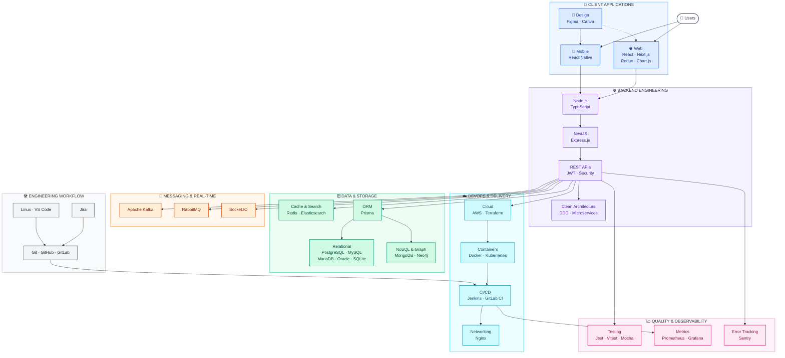

 

# 👋 Hello, I'm a Full-Stack Developer

### 7+ Years of Building Scalable & Modern Software

 

 

---

## 💫 About Me

I'm a **Full-Stack Developer with 7+ years of hands-on coding experience**, specializing in backend engineering and scalable application development.

I enjoy designing reliable systems, writing maintainable code, and building products that solve real-world problems.

- ⚙️ Backend development with Node.js, TypeScript, and NestJS
- 🌐 Modern web applications with React and Next.js
- 📱 Cross-platform mobile development with React Native
- 🏗️ Clean Architecture, DDD, and system design
- 🔐 Secure APIs and authentication systems
- ☁️ Cloud infrastructure, DevOps, and CI/CD
- 📊 Performance, reliability, and observability

---

## 🧩 Engineering Focus

### My Technology Ecosystem

A clean overview of how my engineering technologies connect across application development, backend systems, data, infrastructure, and delivery.

<b>🎨 Diagram color legend</b>

| Color | Engineering Area |
|---|---|
| 🔵 Blue | Frontend & client applications |
| 🟣 Purple | Backend & architecture |
| 🟢 Green | Databases & persistence |
| 🟠 Orange | Messaging & real-time systems |
| 🩵 Cyan | Cloud, DevOps & delivery |
| 🩷 Pink | Testing & observability |
| ⚪ Grey | Development workflow |

---

## 💻 Technology Stack

### Languages

  

### Backend & APIs

  

  
  
  

### Frontend & Mobile

  

  
  

### Databases & Storage

  

  
  
  

### Messaging & Real-Time

  
  
  

### Cloud & DevOps

  

  
  
  
  

### Testing & Development Tools

  

### Design & Machine Learning

  

---

## 📊 GitHub Statistics

 

---

## 📈 Contribution Graph

---

## 🤝 Let's Connect

I'm always open to connecting with developers, collaborating on meaningful projects, and discussing software architecture, backend engineering, and emerging technologies.

 

 

**💡 Clean code. Thoughtful architecture. Software that scales.**

⭐ Thanks for visiting my profile!

