 

# 👋 Hi, I'm a Full-Stack Developer

### 7+ Years of Building Scalable, Reliable & Modern Software

 

 

---

## 💫 About Me

I'm a **Full-Stack Developer with 7+ years of hands-on coding experience**, specializing in backend engineering while building modern web and mobile applications.

I enjoy transforming complex requirements into scalable, secure, and maintainable software. My work spans the complete development lifecycle — from architecture and coding to deployment, monitoring, and continuous improvement.

- ⚙️ Backend engineering with Node.js, TypeScript, and NestJS
- 🌐 Modern web applications with React and Next.js
- 📱 Cross-platform mobile development with React Native
- 🏗️ Clean Architecture, Domain-Driven Design, and system design
- 🔐 Secure APIs, authentication, authorization, and application security
- ☁️ Cloud infrastructure, DevOps, CI/CD, and deployment
- 📊 Performance optimization, observability, and reliability
- 🌱 Continuously learning and improving engineering practices

---

## 🧩 Engineering Focus

### Technology Ecosystem & Software Architecture

The diagram below illustrates how the technologies in my engineering toolkit fit into a modern application ecosystem — from user interfaces and backend services to data storage, messaging, infrastructure, and observability.

> This is a technology capability map, not a claim that every technology is used together in one application. Specific choices depend on project requirements.

```mermaid
flowchart TB
    USER(["👤 Users & Clients"])

    subgraph EXPERIENCE["🎨 Application Experience"]
        WEB["Web Applications<br/>React · Next.js · Redux · Chart.js"]
        MOBILE["Mobile Applications<br/>React Native"]
        DESIGN["UI / UX & Design<br/>Figma · Canva"]
    end

    subgraph BACKEND["⚙️ Backend Engineering"]
        API["API & Application Services<br/>Node.js · TypeScript · Java · Python"]
        FRAMEWORKS["Frameworks & Libraries<br/>NestJS · Express.js"]
        SECURITY["Security & Identity<br/>JWT · Authentication · Authorization"]
        ARCH["Architecture<br/>Clean Architecture · DDD · Microservices"]
    end

    subgraph DATA["🗄️ Data & Persistence"]
        SQL["Relational Databases<br/>PostgreSQL · MySQL · MariaDB · Oracle · SQLite"]
        NOSQL["NoSQL & Specialized Databases<br/>MongoDB · Neo4j"]
        CACHE["Caching & Search<br/>Redis · Elasticsearch"]
        ORM["Data Access<br/>Prisma"]
    end

    subgraph COMMUNICATION["🔄 Messaging & Real-Time"]
        EVENTS["Event Streaming<br/>Apache Kafka"]
        QUEUES["Message Queues<br/>RabbitMQ"]
        REALTIME["Real-Time Communication<br/>Socket.IO"]
    end

    subgraph INFRA["☁️ Infrastructure & DevOps"]
        CLOUD["Cloud & Infrastructure<br/>AWS · Terraform"]
        CONTAINERS["Containers & Orchestration<br/>Docker · Kubernetes"]
        DELIVERY["CI/CD & Automation<br/>Jenkins · GitLab CI"]
        NETWORK["Networking & Web Servers<br/>Nginx"]
    end

    subgraph QUALITY["🧪 Quality & Observability"]
        TESTS["Testing<br/>Jest · Vitest · Mocha"]
        MONITOR["Monitoring & Metrics<br/>Prometheus · Grafana"]
        ERRORS["Error Tracking<br/>Sentry"]
        LOGS["Logging · Performance · Reliability"]
    end

    subgraph WORKFLOW["🛠️ Engineering Workflow"]
        VERSION["Version Control<br/>Git · GitHub · GitLab"]
        COLLAB["Planning & Collaboration<br/>Jira"]
        OS["Development Environment<br/>Linux · VS Code"]
    end

    USER --> WEB
    USER --> MOBILE

    WEB --> API
    MOBILE --> API

    API --> FRAMEWORKS
    FRAMEWORKS --> SECURITY
    FRAMEWORKS --> ARCH

    API --> ORM
    ORM --> SQL
    ORM --> NOSQL
    API --> CACHE

    API --> EVENTS
    API --> QUEUES
    API --> REALTIME

    API --> CLOUD
    CLOUD --> CONTAINERS
    CONTAINERS --> DELIVERY
    DELIVERY --> NETWORK

    API --> TESTS
    INFRA --> MONITOR
    API --> ERRORS
    MONITOR --> LOGS

    VERSION --> DELIVERY
    COLLAB --> VERSION
    OS --> VERSION

    DESIGN -. supports .-> WEB
    DESIGN -. supports .-> MOBILE

    classDef experience fill:#162D50,stroke:#38BDF8,color:#FFFFFF
    classDef backend fill:#3B1F5C,stroke:#A78BFA,color:#FFFFFF
    classDef data fill:#123D36,stroke:#34D399,color:#FFFFFF
    classDef communication fill:#4A2A13,stroke:#FB923C,color:#FFFFFF
    classDef infra fill:#243B53,stroke:#60A5FA,color:#FFFFFF
    classDef quality fill:#4A1942,stroke:#F472B6,color:#FFFFFF
    classDef workflow fill:#343434,stroke:#D4D4D4,color:#FFFFFF

    class WEB,MOBILE,DESIGN experience
    class API,FRAMEWORKS,SECURITY,ARCH backend
    class SQL,NOSQL,CACHE,ORM data
    class EVENTS,QUEUES,REALTIME communication
    class CLOUD,CONTAINERS,DELIVERY,NETWORK infra
    class TESTS,MONITOR,ERRORS,LOGS quality
    class VERSION,COLLAB,OS workflow
```

### Core Engineering Principles

| Area | Focus |
|---|---|
| Architecture | Clean Architecture, DDD, modularity, separation of concerns |
| Backend | Scalable APIs, microservices, event-driven systems |
| Frontend | Reusable components, responsive interfaces, maintainable state |
| Mobile | Cross-platform development and performance |
| Data | Efficient queries, caching, data modeling, persistence |
| Security | Authentication, authorization, secure API design |
| DevOps | CI/CD, infrastructure automation, containerization |
| Reliability | Testing, monitoring, logging, and observability |

---

## 💻 Tech Stack

### Languages

  

### Backend & API Development

  

  
  
  

### Frontend & Web Development

  

  

### Mobile Development

  

### Databases & Data Technologies

  

  
  
  
  

### Messaging & Real-Time Systems

  
  
  

### Cloud, DevOps & Infrastructure

  

  
  
  

### Testing & Quality Engineering

  

### Monitoring & Observability

  

### Version Control & Collaboration

  

### Design & Machine Learning

  

---

## 📊 GitHub Analytics

 

---

## 📈 Contribution Activity

---

## 🤝 Let's Connect

I'm always open to connecting with fellow developers, collaborating on meaningful projects, and discussing backend engineering, system design, architecture, and emerging technologies.

 

### 💡 Building software with purpose, architecture with clarity, and systems that scale.

**Thanks for visiting my profile!** ⭐

Designed with ❤️ and a passion for engineering.

